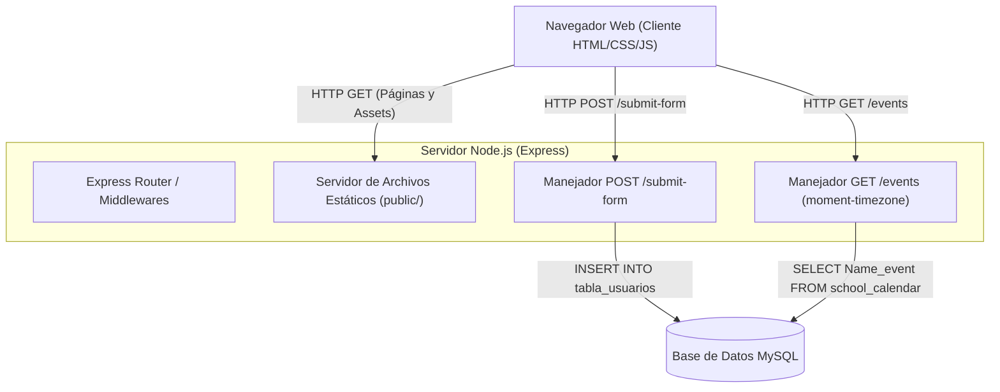

# Colegio Maria Goretti - Landing Page

Plataforma web informativa y de atención a la comunidad educativa para la Institución Educativa Privada Maria Goretti (niveles Inicial y Primaria). Centraliza la difusión de información institucional, propuesta pedagógica y captura solicitudes de contacto y reclamos de padres y apoderados hacia una base de datos relacional.


---

## 1. Funcionalidades Principales

- **Portal informativo modular**: Vistas dedicadas para identidad institucional (misión, visión), propuesta pedagógica (inicial y primaria), plana docente y galería fotográfica.
- **Formulario de consultas y libro de reclamaciones**: Recepción estructurada de requerimientos y reclamos con persistencia en base de datos (`tabla_usuarios`).
- **Servicio de eventos escolares**: Endpoint de consulta para eventos programados en el día, sincronizado con zona horaria (`America/Lima`).
- **Interfaz dinámica**: Soporte para alternancia de tema claro/oscuro, navegación responsive y validación interactiva de formularios con alertas en cliente.

---

## 2. Stack Tecnológico

| Tecnología | Rol en el Proyecto |
| :--- | :--- |
| **Node.js** | Entorno de ejecución en servidor para la lógica backend. |
| **Express.js** | Framework web HTTP para enrutamiento, servicio de estáticos y middlewares. |
| **MySQL / mysql2** | Motor de base de datos relacional y driver de conexión para persistencia de datos. |
| **moment-timezone** | Procesamiento y sincronización de fechas con la zona horaria de Lima (`America/Lima`). |
| **body-parser** | Middleware para parseo de payloads JSON y formularios `application/x-www-form-urlencoded`. |
| **HTML5 / CSS3 / JS Vanilla** | Maquetación, estilos responsivos y lógica de interacción en cliente. |
| **SweetAlert2 / Boxicons / FontAwesome** | Retroalimentación visual, iconografía y diseño de interfaz. |

---

## 3. Arquitectura

El sistema implementa un patrón **Monolítico Web con Renderizado Estático y API REST básica**:
- El servidor Express actúa como despachador de archivos estáticos (`public/`) y expone endpoints HTTP para procesamiento de formularios y consulta de eventos.
- La persistencia se realiza mediante un cliente de conexión directa `mysql2` hacia el servidor de base de datos.



---

## 4. Estructura del Proyecto

```text
colegio-maria-goretti-web/
├── public/                       # Recursos estáticos servidos directamente
│   ├── css/                      # Hojas de estilo por módulo (estilos, tema oscuro, responsive)
│   ├── imagenes/                 # Activos gráficos, logos y fotografías institucionales
│   ├── javascript/               # Lógica del cliente (carruseles, tema oscuro, validaciones)
│   ├── academico.html            # Vista de propuesta educativa y talleres
│   ├── contactanos.html          # Vista de contacto y libro de reclamaciones
│   ├── D.html                    # Vista de plana directiva y docente
│   ├── galeria.html              # Vista de galería fotográfica institucional
│   └── v.html                    # Vista de historia, misión y visión
├── index.html                    # Página de aterrizaje principal
├── index.js                      # Punto de entrada del backend (rutas Express y conexión BD)
├── package.json                  # Definición de dependencias y scripts de ejecución
├── package-lock.json             # Árbol exacto de dependencias de npm
├── .gitignore                    # Reglas de exclusión para Git (ignora node_modules)
└── README.md                     # Documentación técnica del repositorio
```

---

## 5. Seguridad

- **Autenticación y Autorización**: El sistema está concebido como un portal público de consulta y contacto escolar; actualmente **no cuenta con módulos de login, sesiones ni control de acceso basado en roles (RBAC)**.
- **Gestión de Credenciales**: Parámetros de base de datos estructurados para su desacoplamiento mediante variables de entorno en archivo `.env` (excluido de control de versiones).

---

## 6. Especificación de la API

| Método | Endpoint | Descripción | Formato Entrada | Formato Salida |
| :--- | :--- | :--- | :--- | :--- |
| `GET` | `/` | Retorna la página principal del portal. | N/A | `text/html` |
| `GET` | `/events` | Retorna los eventos escolares registrados para la fecha actual en Perú. | N/A | `application/json` |
| `POST` | `/submit-form` | Recibe y persiste el formulario de contacto o reclamo de un apoderado. | `application/x-www-form-urlencoded` o `application/json` | `302 Redirect` a `/` |

### Ejemplo: Consulta de Eventos (`GET /events`)

**Respuesta exitosa (`200 OK` con evento):**
```json
{
  "Name_event": "Simulacro Nacional de Sismo",
  "date": "15-08-2024"
}
```

**Respuesta cuando no hay eventos (`200 OK` sin evento):**
```json
{
  "message": "No hay eventos para hoy"
}
```

---

## 7. Cómo Ejecutar Localmente

### Requisitos Previos
- Node.js (v18 o superior recomendado; probado en v24.x).
- Gestor de paquetes `npm`.
- Instancia accesible de MySQL (local o remota).

### Pasos de Instalación

1. **Clonar el repositorio:**
   ```bash
   git clone https://github.com/LorenzoCampos03/colegio-maria-goretti-web.git
   cd colegio-maria-goretti-web
   ```

2. **Instalar dependencias:**
   ```bash
   npm install
   ```

3. **Configurar variables de entorno:**
   - Crear un archivo `.env` en la raíz del proyecto basándose en `.env.example`:
     ```env
     PORT=3000
     DB_HOST=localhost
     DB_PORT=3306
     DB_USER=root
     DB_PASSWORD=tu_password
     DB_NAME=defaultdb
     ```

4. **Ejecutar el servidor:**
   - Modo desarrollo (con recarga automática):
     ```bash
     npm start
     ```
   - Modo producción / directo:
     ```bash
     node index.js
     ```

5. **Acceder a la aplicación:**
   Abrir en el navegador: [http://localhost:3000](http://localhost:3000)

> [!NOTE]
> El proyecto no cuenta actualmente con contenedorización en Docker.

---

## 8. Pruebas

- **Estado actual**: El repositorio no dispone de una suite de pruebas automatizadas (unitarias o de integración). El script `npm test` no está configurado.

---

## 9. CI/CD

- **Estado actual**: No existe pipeline de integración continua ni despliegue continuo configurado (sin GitHub Actions ni workflows).

---

## 10. Rol y Aportes en el Proyecto

- **Modalidad**: Proyecto individual (desarrollo integral autónomo).
- **Responsabilidades asumidas**:
  - Arquitectura y desarrollo integral del backend con Node.js y Express.
  - Modelado y persistencia en MySQL para captura de formularios y consultas de apoderados.
  - Implementación del servicio de calendario escolar con ajuste de zona horaria (`America/Lima`).
  - Maquetación de vistas frontend y dinamismo en JavaScript (tema oscuro/claro, navegación responsiva y validaciones).
- **Resultados e impacto**:
  - **1.er lugar en la presentación de proyectos finales de ciclo**, reconocido por su completitud funcional, integración de base de datos y diseño de experiencia de usuario.

---

## 11. Roadmap / Posibles Mejoras

1. **Externalización y seguridad de configuración**: Implementar `dotenv` para aislar parámetros de base de datos fuera del código fuente.
2. **Suite de pruebas**: Integrar **Jest** y **Supertest** para pruebas unitarias de controladores y pruebas de integración sobre los endpoints HTTP.
3. **Contenedorización**: Incorporar `Dockerfile` y `docker-compose.yml` para desacoplar el entorno y levantar la aplicación junto a MySQL con un solo comando.

---

## 12. Contacto

- **Autor**: Lorenzo Campos
- **LinkedIn**: [linkedin.com/in/lorenzo-campos](https://www.linkedin.com/in/lorenzo-campos)
- **Correo Electrónico**: [lorenzo.campos.p@vallegrande.edu.pe](mailto:lorenzo.campos.p@vallegrande.edu.pe)
